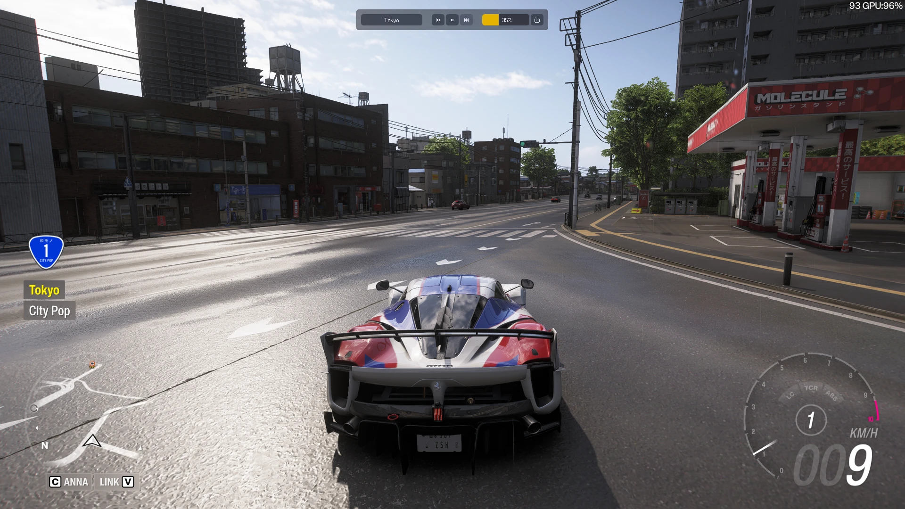

# Forza Radio DX

Replaces the radio in Forza Horizon 6 with a curated set of online radio
stations.

## Features

- **Online radio.** Curated stations with logos and album art on the radio HUD.
- **Fast boot.** Skips the intro wait.
- **DualSense triggers.** Adaptive trigger feedback for braking and
  acceleration. Off by default.
- **Overlay.** Press **Insert** to show or hide the player bar.
- **Pixel or modern font.** Modern is for DPI scaling and might look slightly
  off.
- **No pause when you tab out.** Optional.

## Install

1. Close the game and extract the download into the folder that contains
   `forzahorizon6.exe`.
2. In the game, turn on **Settings → Audio → Streamer Mode**.
3. Start playing and pick a station.

To remove it, delete `version.dll` and the `mods/frdx` folder.

## Credits

- [g0ldyy/fh6-universal-radio](https://github.com/g0ldyy/fh6-universal-radio):
  this project started as a mod of it.
- [TigerHix/fh6_fastboot](https://github.com/TigerHix/fh6_fastboot):
  the fast boot.
- [HamzaYslmn/Forza-Horizon-DualSense-Python](https://github.com/HamzaYslmn/Forza-Horizon-DualSense-Python):
  the DualSense triggers, ported to C++.

Fonts:

- [Fusion Pixel Font](https://github.com/TakWolf/fusion-pixel-font) by TakWolf
  (pixel font, SIL OFL).
- [Geist](https://github.com/vercel/geist-font) by Vercel (modern font, SIL OFL).
- [Source Han Sans](https://github.com/adobe-fonts/source-han-sans) by Adobe
  (Japanese and Korean text in the modern font, SIL OFL).
- [Kenney Game Icons](https://kenney.nl/assets/game-icons) by Kenney (button
  icons, CC0).

## License

GPLv3, see [LICENSE](LICENSE). This is an unofficial fan project and isn't
affiliated with Turn 10, Playground Games, Xbox Game Studios or Microsoft.
